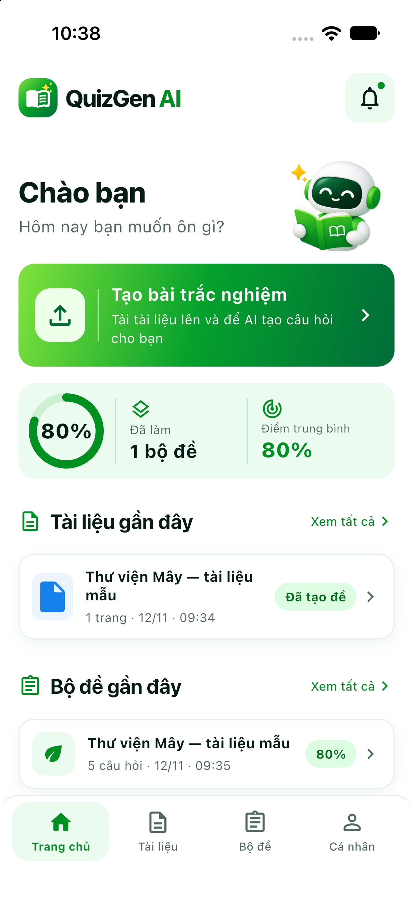
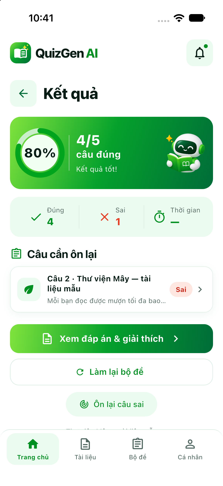

# Kiểm tra QuizMind AI — 12/11/2026

Phạm vi: bản Flutter `0.1.0+1`, relay Python trên Mac, trích xuất PDF/OCR bằng PDFKit và Vision. Đây là bản local cho một người dùng. Chưa có commit, push hay triển khai production.

## Kết quả build và Flutter

| Kiểm tra | Kết quả |
| --- | --- |
| `flutter analyze --no-pub` | PASS, không có issue |
| `dart format lib test` | PASS |
| `flutter test --no-pub --reporter expanded` | PASS, 7 test |
| `python3 -m unittest discover -s server -p 'test_*.py' -v` | PASS, 6 test offline |
| `flutter build ios --simulator --debug --no-pub` | PASS |
| `flutter build macos --debug --no-pub` | BLOCKED, lỗi TLS khi tải chỉ mục CocoaPods |

Bảy test Flutter kiểm tra: địa chỉ loopback/không redirect/không gửi khóa; thư viện rỗng và tài liệu mẫu; khôi phục nháp, nộp cùng mã lần làm và lời giải nguồn; tìm tài liệu/cảnh báo không có kết quả; đánh dấu/bỏ qua/nhảy câu và khôi phục vị trí; lọc chỉ câu sai vẫn giữ trích dẫn; sáu màn chính ở 320×740 với text scale 1,25 và 1024×1366. Test bố cục phát hiện lỗi Flutter/overflow, chưa thay thế đối chiếu hình ảnh hoặc kiểm toán accessibility.

Sáu test server dùng dữ liệu tạm và cấu hình giả, không gọi AI thật: chấp nhận quote có trong nguồn, từ chối quote chỉ khoảng trắng, bỏ qua proxy môi trường, rollback bộ nhớ/đĩa khi `os.replace` lỗi rồi cho phép thử lại, từ chối tệp sai định dạng và giữ tài liệu qua restart, chấm điểm và nộp bài lặp không tạo bản ghi trùng. Chưa đo tỷ lệ coverage. Các test đã được chạy lại bởi agent chính sau khi rà soát độc lập.

Build iOS tạo `build/ios/iphonesimulator/Runner.app` và đã cài, mở trên simulator. Không phải bản ký để phân phối hoặc cài lên thiết bị thật.

## API AI và luồng ứng dụng thật

- Kết nối thành công đến API đã cấu hình tại `http://localhost:57220/v1`, gồm `/models` và `/chat/completions`. Khóa nằm ngoài dự án, không nằm trong app.
- Nhập tài liệu mẫu tổng hợp **Thư viện Mây** qua giao diện và tạo thành công một bộ 5 câu. Trường `model` trong phản hồi thực tế là `gpt-6.1-sol`.
- Trên iPhone 17 Simulator: chọn đáp án câu đầu, đóng/mở lại app và mở lại đề; đáp án nháp được giữ.
- Cố ý chọn sai một câu, nộp bài và nhận đúng **4/5**, có lời giải và trích đoạn nguồn theo trang.
- Gửi lại mã yêu cầu của tác vụ tạo đề đã hoàn tất trả về cùng tác vụ; số tác vụ và số bộ đề không tăng, không phát sinh lần tạo AI mới.
- Dừng và mở lại relay: tài liệu, bộ đề, lần làm và điểm 4/5 được giữ. Không tự gọi lại AI.
- Trích xuất PDF và nhận dạng PNG từ fixture tổng hợp đều trả một trang 232 ký tự, có nội dung mong đợi. Đây chưa phải kiểm tra mọi loại tài liệu thực tế.

Các bước AI thật trên thuộc lần kiểm tra chức năng trước khi restyle. Chỉ một lần tạo đề qua AI thật đã được dùng, bằng tài liệu mẫu không chứa dữ liệu riêng. Trong lượt restyle không tạo thêm đề hoặc nộp thêm lần làm: dùng dữ liệu đã có, mở lại kết quả và cập nhật một nháp khi kiểm tra chọn đáp án. API local có thể chuyển tiếp đến nhà cung cấp bên ngoài; không khẳng định AI chạy hoàn toàn offline.

## Kiểm tra khóa và lưu trữ

Đã dò giá trị khóa thật trong mã nguồn/tài liệu/cấu hình và 115 tệp của app iOS đã build: không có kết quả khớp. Phép kiểm tra chỉ xuất số lượng và trạng thái, không xuất khóa. Thư mục cấu hình có quyền `0700`; tệp cấu hình và bản lưu dữ liệu có quyền `0600`. Đây là kiểm tra khóa đang cấu hình, chưa phải kiểm toán bảo mật toàn diện.

## Giao diện đã xem

- Restyle theo sáu ảnh người dùng: màu trắng/mint/xanh lá, gradient, robot và icon. Tên thương hiệu trong app là QuizGen AI theo ảnh; tên dự án giữ QuizMind AI.
- iPhone 17 Simulator: trang chủ, thư viện, nhập tài liệu, cấu hình, làm bài, kết quả, giải thích chỉ câu sai và màn quét; không thấy tràn chữ ở các màn hình đã chụp. Cuối lượt kiểm tra app được để ở trang chủ.
- iPad Pro 13 Simulator: trang chủ với nội dung căn giữa, thống kê và điều hướng hiển thị đầy đủ. Đây là kiểm tra màn hình rộng trên iPad, chưa phải macOS desktop.
- Đã đọc skill design-review và review render thủ công; skill cài sẵn chỉ là mục giới thiệu, chưa có bộ audit upstream. Chưa đo phần trăm giống tham chiếu hoặc kiểm toán accessibility toàn diện.

| Trang chủ iPhone | Kết quả iPhone |
| --- | --- |
|  |  |

[Thư viện](restyle/iphone-library.png) · [Cấu hình](restyle/iphone-config.png) · [Màn làm bài](restyle/iphone-quiz.png) · [Quét](restyle/iphone-scan.png) · [Trang chủ iPad](restyle/ipad-home.png) · [Trước restyle](restyle/iphone-before.png)

## REA và simulator

Đã dùng REA `capture_process_scenario` với `/usr/bin/xcrun simctl launch BBCB774C-937A-4185-A46B-88B6764E6195 dev.quyet.quizmind`; lệnh kết thúc mã 0. Evidence ID: `ev_f6839a7ede5ff1b3fb0dccc1085d4529b79e4df372ee43b6ef2c5a72bade882f`. Việc liệt kê simulator trước đó có evidence `ev_1c8f8f56db905bb2371e415eb60a3c2f53eff816f18043b9cb6a3a12c2b53f54`.

Giới hạn evidence REA: cây tiến trình lấy mẫu không đầy đủ, không có quan sát filesystem, không xác minh môi trường kế thừa hoặc định danh artifact. REA chứng minh lần chạy lệnh đã quan sát, không chứng minh độ giống giao diện. Render và tương tác được kiểm tra riêng qua CUA cùng ảnh PNG từ `simctl`.

Build mới đã cài và mở trên iPhone 17 iOS 27 (`BBCB774C-937A-4185-A46B-88B6764E6195`) và iPad Pro 13 M5 (`B1F326F3-7F0B-417C-8314-93050673F338`), bundle `dev.quyet.quizmind`. Health check relay sau restyle trả `ok: true`, `configured: true`.

## Giới hạn còn lại

- macOS: CocoaPods không tải được `https://cdn.cocoapods.org/all_pods_versions_c_0_4.txt`; thử trực tiếp bằng curl cũng lỗi TLS `SSL_ERROR_SYSCALL`. Không tắt kiểm tra TLS để vượt lỗi.
- Chưa build/chạy Android, chưa thử camera và định dạng ảnh thực tế trên thiết bị thật. iPhone thật chưa được hỗ trợ qua LAN vì relay chỉ nghe loopback. Android cần `adb reverse` như README.
- Chưa có font/icon/robot gốc để bảo đảm trùng ảnh tuyệt đối. Camera dùng trình chụp hệ thống, chưa có preview trực tiếp/tự bắt cạnh trong khung. Cấu hình hiện chỉ có 5/10/15 câu, độ khó tự động, luyện tập và toàn bộ tài liệu; khác một số lựa chọn minh họa. Xem [quyết định giao diện](../design/DESIGN.md).
- TXT/MD UTF-8, PDF tối đa 20 trang, JPG/PNG; tổng 12 MB, tối đa 10 ảnh, chữ trích xuất từ 80 đến 50.000 ký tự. Chưa hỗ trợ DOCX/PPTX.
- Ẩn tài liệu không xóa vĩnh viễn dữ liệu đã lưu. Bản lưu chưa mã hóa riêng; JSON hỏng hiện cần xử lý thủ công để relay mở lại.
- Đối chiếu quote chỉ xác nhận đoạn trích có trong nguồn, chưa bảo đảm đáp án và suy luận AI luôn đúng.

Hướng dẫn cấu hình, chạy và vị trí dữ liệu: [README](../../README.md).

Kiểm thử đọc ba fixture và tạo ba bộ đề thật: [báo cáo tạo câu hỏi](quiz-generation-2026-11-12.md).
